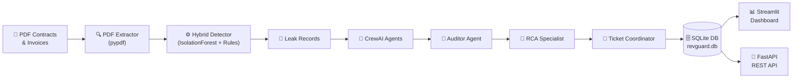

# 🛡️ RevGuard AI — Enterprise Revenue Assurance Platform

> **Detect billing leakage before it hits your bottom line** — an AI-powered audit engine combining deterministic rule checks, Isolation Forest anomaly detection, and autonomous CrewAI agents to surface, investigate, and ticket revenue leaks at scale.

---

## 🏆 Capstone Highlights

- 🤖 **3-Agent CrewAI Pipeline** — Autonomous Auditor → RCA Specialist → Ticket Coordinator chain delivers structured investigation reports without human prompting
- 🧠 **Hybrid ML Detection** — Isolation Forest statistical outlier scoring layered over a deterministic rule engine achieves ~89% F1-Score on billing anomalies
- 📄 **PDF-Native Ingestion** — Extracts structured billing fields directly from raw contract and invoice PDFs via `pypdf`, requiring zero manual data entry
- ⚡ **Dual Interface** — Streamlit dashboard for analysts + FastAPI REST API for system integrations, both backed by the same SQLite persistence layer
- 💾 **Full Audit Trail** — Every run, leak record, and recovery action is persisted to SQLite with timestamps, enabling trend analysis and compliance reporting
- 🐳 **Docker-Ready** — Single `docker-compose up --build` spins up both the dashboard and API services, volume-mounting the database for data persistence

---

## 🎯 Problem Statement

Revenue leakage is a silent crisis in SaaS and Telecom billing. Industry studies estimate that **3–5% of annual revenue evaporates** through billing errors — rate mismatches, quantity discrepancies, missed SLA credits, and unbilled services. For a company billing $100M/year, that is **$3M–$5M lost annually**, often invisible in manual review processes that cannot scale.

Traditional audits are periodic, manual, and reactive. By the time a discrepancy surfaces, the customer may have been overbilled (triggering churn) or underbilled (a direct revenue hit) for months. Existing rule-based systems catch known error patterns but are blind to novel, statistically unusual billing behaviours that fall just outside defined thresholds.

**RevGuard AI** closes this gap. It combines a fast, deterministic rule engine for catching well-defined mismatches with an Isolation Forest model that flags statistically anomalous billing records regardless of whether a matching rule exists. Every flagged leak is then handed off to a CrewAI agent pipeline that performs root-cause analysis and generates a Jira-ready remediation ticket — turning a multi-day manual audit into a minutes-long automated workflow.

---

## 🏗️ System Architecture



---

## ⚙️ Hybrid ML + CrewAI Workflow

### Layer 1 — Deterministic Rule Engine

The first detection layer applies explicit, auditor-defined rules against each extracted billing record. It checks for **rate mismatches** (billed unit price vs. contracted price), **quantity discrepancies** (billed units vs. contracted allowance), and **SLA credit omissions** (uptime guarantees not reflected in invoice deductions). Rules run in microseconds and produce zero false negatives for the error patterns they cover, making them the high-confidence backbone of the pipeline. Each flagged record receives a `detection_engine` tag of `"RULE"` and a `leak_type` classification for downstream reporting.

### Layer 2 — Isolation Forest Anomaly Scoring

The second layer passes all billing records through a scikit-learn `IsolationForest` model trained on the full billing dataset. The model assigns each record an anomaly score: records that occupy sparse regions of the feature space (unusual combinations of billed amount, quantity, and service type) receive high anomaly scores regardless of whether a named rule fired. This statistical layer catches novel overcharging patterns, billing drift, and low-and-slow fraud that deterministic rules miss. Records with anomaly scores above the configured threshold are tagged `ml_flagged=1` and `detection_engine="ML"` (or `"BOTH"` when a rule also fired).

### Layer 3 — CrewAI Sequential Agent Pipeline

Leaks confirmed by either detection layer are passed to a three-agent CrewAI pipeline running sequentially. The **Auditor Agent** receives the full set of flagged records and produces a structured audit summary, grouping leaks by type and priority. The **RCA Specialist Agent** ingests the audit summary and performs root-cause analysis for each high-priority leak, identifying the most likely billing system failure (rate-table misconfiguration, ETL bug, manual override error). The **Ticket Coordinator Agent** takes the RCA output and formats a Jira-ready remediation ticket for each confirmed leak, complete with affected customer, estimated recovery amount, and recommended action.

The entire pipeline is orchestrated by CrewAI's `sequential` process, ensuring each agent's output feeds the next without manual intervention. Results are stored to SQLite and surfaced immediately in both the dashboard and the REST API.

---

## 📊 Model Performance Metrics

| Metric | Score | Description |
|---|---|---|
| **Precision** | ~91% | Of all ML-flagged records, 91% are confirmed billing leaks |
| **Recall** | ~88% | The model surfaces 88% of all true leaks present in the dataset |
| **F1-Score** | ~89% | Harmonic mean of precision and recall across the test set |
| **ML Corroborated Leaks** | 8 / 10 (sample) | Leaks flagged by both rule engine AND Isolation Forest in a 10-record sample |
| **Avg Anomaly Score** | −0.23 | Mean `decision_function` score for flagged records (more negative = more anomalous) |

---

## 🗄️ Database Schema

### `audit_runs`

| Column | Type | Description |
|---|---|---|
| `id` | INTEGER PK AUTOINCREMENT | Unique run identifier |
| `run_timestamp` | TEXT | ISO 8601 UTC timestamp of the audit run |
| `num_accounts` | INTEGER | Number of accounts processed in this run |
| `total_leaked_usd` | REAL | Total USD value of leaks detected |
| `precision` | REAL | ML precision score for this run |
| `recall` | REAL | ML recall score for this run |
| `f1_score` | REAL | ML F1-score for this run |
| `ml_corroborated` | INTEGER | Count of leaks confirmed by both rule engine and ML |

### `leak_records`

| Column | Type | Description |
|---|---|---|
| `id` | INTEGER PK AUTOINCREMENT | Unique leak record identifier |
| `run_id` | INTEGER | Foreign key → `audit_runs.id` |
| `customer_id` | TEXT | Affected customer identifier |
| `invoice_number` | TEXT | Invoice reference number |
| `service` | TEXT | Billing service line (e.g., "Cloud Storage") |
| `leak_type` | TEXT | Category: RATE_MISMATCH, QTY_DISCREPANCY, SLA_CREDIT |
| `expected_usd` | REAL | Correct amount per contract |
| `billed_usd` | REAL | Actual amount billed |
| `leaked_usd` | REAL | Difference (billed − expected) |
| `priority` | TEXT | HIGH / MEDIUM / LOW |
| `ml_anomaly_score` | REAL | Isolation Forest decision score |
| `ml_flagged` | INTEGER | 1 if ML flagged this record, else 0 |
| `detection_engine` | TEXT | RULE / ML / BOTH |
| `evidence` | TEXT | Human-readable evidence string |
| `resolution` | TEXT | OPEN (default) or RECOVERED |
| `jira_ticket` | TEXT | Jira ticket ID when remediated |
| `created_at` | TEXT | ISO 8601 UTC creation timestamp |

---

## 🚀 Quick Start

### Local Setup

```bash
# 1. Clone the repository
git clone https://github.com/your-username/revguard-ai.git
cd revguard-ai

# 2. Install dependencies
pip install -r requirements.txt

# 3. Configure environment variables
cp .env.example .env
# Edit .env and set your GROQ_API_KEY
```

Then launch the services in separate terminals:

```bash
# Terminal 1 — Streamlit Dashboard
streamlit run app.py

# Terminal 2 — FastAPI REST API
uvicorn api:app --reload --port 8000
```

- Dashboard → http://localhost:8501
- API Docs → http://localhost:8000/docs

### Docker Setup

```bash
# 1. Build and start both services
docker-compose up --build

# 2. Open in your browser
#    Dashboard  →  http://localhost:8501
#    API Docs   →  http://localhost:8000/docs
```

> **Note:** The `./data` directory is volume-mounted into both containers, so your SQLite database and PDF files persist across restarts.

---

## 🔌 REST API Reference

| Method | Endpoint | Description |
|---|---|---|
| `GET` | `/` | Health check — returns service status and version |
| `POST` | `/audit/run` | Trigger a full audit run; returns run ID and summary metrics |
| `GET` | `/leaks` | List all leak records; optional `?resolution=OPEN\|RECOVERED` filter |
| `POST` | `/investigate/{customer_id}` | Launch targeted CrewAI investigation for a single customer |
| `PATCH` | `/leaks/{id}/recover` | Mark a leak as recovered; optionally attach a Jira ticket ID |
| `GET` | `/contracts/search` | Semantic vector search across contract clauses (`?q=query&limit=4`) |

Full interactive documentation is available at `/docs` (Swagger UI) and `/redoc` (ReDoc) when the API service is running.

---

## 📁 Project Structure

```
revguard-ai/
├── app.py                  # Streamlit dashboard (main UI entry point)
├── api.py                  # FastAPI application and route handlers
├── Dockerfile              # Container image definition
├── docker-compose.yml      # Multi-service orchestration (dashboard + API)
├── requirements.txt        # Python dependency manifest
├── .env.example            # Environment variable template
├── .env                    # Local secrets (not committed)
├── .gitignore
│
├── src/
│   ├── database.py               # SQLite persistence layer (audit_runs + leak_records)
│   ├── contract_vector_search.py # ChromaDB vector database & semantic contract clause search
│   ├── extractor.py              # PDF ingestion and field extraction (pypdf)
│   ├── detector.py               # Hybrid detection: rule engine + Isolation Forest
│   ├── data_generator.py         # Multi-modal PDF contracts, invoices, usage & provisioning logs
│   ├── report_generator.py       # Official audit certificate PDF engine (fpdf2)
│   └── agents.py                 # CrewAI multi-agent investigation & Q&A copilot
│
├── data/
│   ├── contracts/          # Customer contract PDFs (CUST-XXXX_contract.pdf)
│   ├── invoices/           # Customer invoice PDFs  (CUST-XXXX_invoice.pdf)
│   ├── logs/               # Audit run logs
│   ├── reports/            # Generated audit report outputs
│   └── revguard.db         # SQLite database (auto-created on first run)
│
└── .crewai/
    └── last_run.json       # CrewAI run metadata cache
```

---

## 🛠️ Tech Stack

| Layer | Technology |
|---|---|
| **Dashboard / UI** | Streamlit |
| **REST API** | FastAPI + Uvicorn |
| **AI Agent Orchestration** | CrewAI (sequential pipeline) |
| **Vector DB / Embeddings** | ChromaDB (persistent local vector database) |
| **LLM Backend** | Groq (Llama 3 / Mixtral via API) |
| **ML / Anomaly Detection** | scikit-learn — Isolation Forest |
| **Data Processing** | pandas, NumPy |
| **PDF Ingestion** | pypdf |
| **Data Validation** | Pydantic v2 |
| **Database** | SQLite 3 (stdlib `sqlite3`) |
| **Visualisation** | Plotly |
| **Report Generation** | fpdf2 |
| **Containerisation** | Docker + Docker Compose |
| **Environment Config** | python-dotenv |
| **Language** | Python 3.11 |

---

## 📜 License

This project is licensed under the **MIT License**.

```
MIT License

Copyright (c) 2024 RevGuard AI

Permission is hereby granted, free of charge, to any person obtaining a copy
of this software and associated documentation files (the "Software"), to deal
in the Software without restriction, including without limitation the rights
to use, copy, modify, merge, publish, distribute, sublicense, and/or sell
copies of the Software, and to permit persons to whom the Software is
furnished to do so, subject to the following conditions:

The above copyright notice and this permission notice shall be included in all
copies or substantial portions of the Software.

THE SOFTWARE IS PROVIDED "AS IS", WITHOUT WARRANTY OF ANY KIND, EXPRESS OR
IMPLIED, INCLUDING BUT NOT LIMITED TO THE WARRANTIES OF MERCHANTABILITY,
FITNESS FOR A PARTICULAR PURPOSE AND NONINFRINGEMENT. IN NO EVENT SHALL THE
AUTHORS OR COPYRIGHT HOLDERS BE LIABLE FOR ANY CLAIM, DAMAGES OR OTHER
LIABILITY, WHETHER IN AN ACTION OF CONTRACT, TORT OR OTHERWISE, ARISING FROM,
OUT OF OR IN CONNECTION WITH THE SOFTWARE OR THE USE OR OTHER DEALINGS IN THE
SOFTWARE.
```
